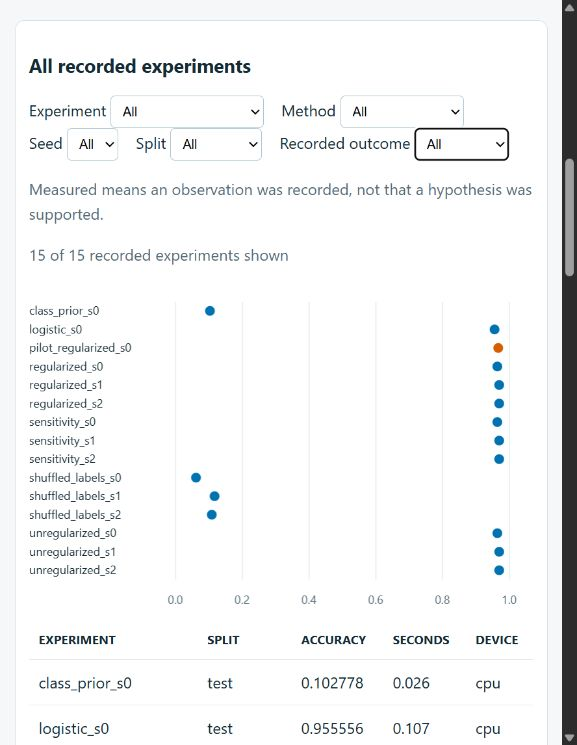
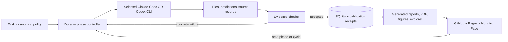

# Auto Eureka Scientist

A resumable Python harness for research through **one selected coding CLI per run**: Claude Code or Codex. It sends the original policy, task, phase objective, and durable evidence into fresh contexts; checks artifacts; and advances through research, preregistration, implementation, pilot, comparisons, analysis, review, and publication.

The motivation is inspectable execution: an agent's claim that it finished is insufficient. Protocol hashes, predictions, checkpoint hashes, source retrievals, publication receipts, and SQLite state make completion and failure visible. The workflow incorporates [Neel Nanda's research process](https://www.alignmentforum.org/s/5GT3yoYM9gRmMEKqL) and lessons from [Anthropic's long-running harness](https://www.anthropic.com/research/effective-harnesses-for-long-running-agents). It does not guarantee correct science. See the [source and license review](docs/sources.md).

The original Haiku trial stopped at its time limit with missing phases. Luna completed its controller phases but needed mechanical provenance repairs. The user then authorized a larger budget, simpler handoffs, and separate Sonnet and GPT-6.1 Sol replications. The [generated validation report](reports/validation-summary.md) separates the original cutoff from extended results; [audit disclosures](reports/validation-interpretation.md) explain interventions and limitations. The [original protocol](reports/validation-preregistration.md) and [prospective extension](reports/validation-extension-preregistration.md) remain separate.



[Results hub](https://burnycoder.github.io/auto-eureka-scientist-agent-harness/) · [Validation paper](reports/validation-paper.pdf) · [Reproduce published artifacts](docs/reproduction.md) · [Haiku explorer](https://burnycoder.github.io/eureka-digits-haiku/) · [Luna explorer](https://burnycoder.github.io/eureka-digits-luna/)



## Installation

Install [uv](https://docs.astral.sh/uv/), Python 3.14, Git, the [GitHub CLI](https://cli.github.com/), the [HF CLI](https://huggingface.co/docs/huggingface_hub/guides/cli), [Pandoc](https://pandoc.org/installing.html), and LaTeX with `pdflatex`. Install and authenticate the chosen [Claude Code](https://code.claude.com/docs/en/quickstart) or [Codex CLI](https://learn.chatgpt.com/docs/non-interactive-mode). The harness uses their existing logins; no API key is required by the harness.

```powershell
git clone https://github.com/BurnyCoder/auto-eureka-scientist-agent-harness.git
cd auto-eureka-scientist-agent-harness
uv sync --locked --extra research
Copy-Item .env.example .env
gh auth login
hf auth login
uv run --extra research eureka doctor
uv run --extra research pytest
```

For the CUDA validation environment, use `uv sync --locked --extra research --extra cuda` and retain those extras in subsequent `uv run` commands. The explicit CUDA wheel index is recorded in `pyproject.toml` and `uv.lock`; the newest CPU wheel and newest available CUDA wheel can differ. CUDA is used only when PyTorch reports it available. General research execution requires the base package; scientific rendering requires the `research` extra. PDF compilation also requires the external tools above.

## Run a project

Write the research task in a UTF-8 file. Backend selection is required. CLI arguments override project `.env` defaults; existing environment variables override `.env`. The model defaults are `haiku` for Claude and `gpt-6-luna` for Codex.

```powershell
uv run --extra research eureka init --project workspaces/my-study
uv run --extra research eureka run --project workspaces/my-study --task my-task.md --backend claude --model haiku --mode cycle
uv run --extra research eureka status --project workspaces/my-study
uv run --extra research eureka stop --project workspaces/my-study
uv run --extra research eureka resume --project workspaces/my-study
uv run --extra research eureka verify --project workspaces/my-study
uv run --extra research eureka render --project workspaces/my-study
```

`init` can attach an existing directory and preserves existing instructions and README. `run` also initializes missing project scaffolding. It creates a new recorded run; `resume` continues the latest run or `--run-id`, retaining backend, model, elapsed time, and consumed calls. Explicit limits can extend a run: `eureka resume --project workspaces/my-study --max-minutes 180 --max-calls 60`. These are total limits, not extra allowances. Configuration history records the change without resetting counters. Preserve a bounded trial's cutoff result separately when extending it.

`cycle` stops after a completed cycle. `continuous` starts separately recorded cycles until stopped or a limit is met. `budget` requires `--max-minutes` or `--max-calls`. Optional `--max-cycles` also limits continuous/budget operation. Time means active controller wall time, including checks and publication; downtime between resumes does not consume it. Every CLI invocation, including failures and retries, consumes a call. There are at most two targeted repairs and two transient retries per phase execution. Persistent failure leaves resumable state. `stop` and Ctrl+C terminate owned CLI processes. A hard OS crash can require manual inspection of orphaned processes.

Publication is enabled by default; `--no-publish` records local receipts for local work. `--owner` and `--repository` select GitHub destinations. Public runs create a public repository, commit the preregistration, merge core and pilot PRs, upload checkpoints, and deploy a static explorer. Only the controller owns Git/publication operations during the run. Authentication/access failures are resumable and never treated as completed publication.

## Models and execution permissions

Any model identifier can be passed through `--model`, `EUREKA_CLAUDE_MODEL`, or `EUREKA_CODEX_MODEL`. Availability is determined by the selected CLI and account; unavailable models produce an error without substitution. General runs are not restricted to the two validation models.

For example, Claude runs can request `--model sonnet` or `--model opus`, and Codex runs can request `--model gpt-6.1-sol`. Availability is account-dependent. The digits profiles permit the user-authorized Haiku, Luna, Sonnet and GPT-6.1 Sol selections. Model identity cannot change on resume. The [prospective extension addendum](reports/validation-extension-preregistration.md) defines the new trials; results are reported only after execution.

Claude uses `--dangerously-skip-permissions`, session settings that disable its sandbox and fallback list, streaming JSON, and a pinned helper model. Codex uses `--dangerously-bypass-approvals-and-sandbox`, `web_search="live"`, JSONL, and the selected model. Validation disables Codex's native multi-agent feature so uncounted helper inference cannot escape its call budget. No harness action classifier or permission dialog is added. Provider-side model policies remain in effect. Commands run with the user's normal machine/network access; only run tasks you intend to authorize.

All emitted stdout/stderr and complete prompts are written to terminal and timestamped files beneath `.eureka/<run>/<attempt>/`. Raw bytes, transcripts, prompt hashes, parsed outcomes, reported usage and model identifiers are preserved. A missing reported cost remains unknown. Some CLI event formats do not expose a resolved model snapshot; the audit distinguishes a requested identifier from a reported identity.

## Research and data flow

| Phase | Observable completion evidence |
|---|---|
| Scope and research | Domain, question, source/license ledger, inspected URLs, highlights |
| Preregister | Protocol, alternatives, distinguishing predictions, metrics/data boundaries, immutable committed hash |
| Implement and publish core | Working code, rerun check command, reproduction instructions, merged/pushed checkpoint |
| Pilot and publish | Validation predictions, logs/checkpoint, preliminary report and publication receipt |
| Comparisons | Registered controls/baselines/ablations, seed/sensitivity outcomes, retained failures |
| Analyze and distill | Evidence-linked claims, generated numerical artifacts, requirement checklist |
| Review and repair | One substantive review, concrete repairs or explicit evidence backedge |
| Publish and decide | Final report, GitHub/HF receipts, Pages configuration, stop/next-cycle decision |

Within these phases, agents record ideation, exploration, understanding, or distillation; objectives, predictions, alternatives, observations, learning, and selection rationale. Exploration can lack a mature hypothesis. It cannot later be relabeled as preregistered confirmation. Revised protocols require a new cycle; earlier versions and results remain. A fresh evaluation boundary is required for new confirmation. See [research contracts](docs/research-contracts.md).

`eureka render` regenerates numerical tables, paired bootstrap intervals, figures, per-experiment and consolidated reports, paper Markdown/PDF, model-card metrics, README results, and `site/data.json` from saved experiment JSON. Authored interpretation stays separate. The browser explorer filters methods, seeds and evaluation splits, shows loss curves and deterministic output examples, and links primary sources. Reports identify omitted or inapplicable metrics. Negative or inconclusive scientific outcomes can successfully complete a cycle.

## Fixed validation

```powershell
uv run --extra research --extra cuda eureka run --project workspaces/eureka-digits-haiku --task tasks/digits.md --backend claude --model haiku --profile digits --max-minutes 60 --max-calls 20 --owner BurnyCoder
# Start after the Haiku trial ends, with an independent directory/repository.
uv run --extra research --extra cuda eureka run --project workspaces/eureka-digits-luna --task tasks/digits.md --backend codex --model gpt-6-luna --profile digits --max-minutes 60 --max-calls 20 --owner BurnyCoder
```

The [fixed machine-readable protocol](src/auto_eureka_scientist/resources/digits_protocol.json) uses scikit-learn's bundled [UCI digits](https://archive.ics.uci.edu/dataset/80/optical+recognition+of+handwritten+digits), frozen stratified train/validation/test partitions, a fixed ReLU MLP with AdamW, regularization ablations, logistic regression, a class-prior baseline, shuffled training labels, and seed/sensitivity comparisons. The pilot is published before comparisons. The primary effect and uncertainty are regenerated from paired test predictions. Intervals condition on the trained models; seed variability is reported separately. No test outcome selects a configuration.

The supplied training fixture makes these trials tests of research orchestration and inspection, not independent algorithm invention or model superiority. GPU time is used for neural experiments. No harness weights exist to upload. Trained validation checkpoints are organized in the [shared research collection](https://huggingface.co/collections/BurnyCoder/auto-eureka-scientist-6ae3ae37b267f00aef999f75); pass its slug with `--hf-collection` to reuse it.

For replications after observing prior results, use `--profile digits-replication --task tasks/digits-replication.md`. The protocol and result records are explicitly exploratory. The original validation defaults remain bounded; `--max-minutes 180 --max-calls 60` explicitly selects the user-authorized extension. `eureka verify --project PATH --phase analysis` checks draft files without accepting a phase. Paths can be relative to the cycle or project when unambiguous; the prompt includes a complete handoff example.

The model collections are [Haiku's digits checkpoints](https://huggingface.co/collections/BurnyCoder/eureka-digits-haiku-6ae38bdd8bdaca1527379a69) and [Luna's digits checkpoints](https://huggingface.co/collections/BurnyCoder/eureka-digits-luna-6ae39b1a9fbf13c0618b07a5). The generated tables below compare methods, controls and ablations. In plain language, regularization did not improve observed accuracy over the unregularized network; shuffled-label controls performed much worse than real-label training. This narrow result does not establish equivalence or rule out every confound.

## Development and provenance

Python standard-library asyncio, subprocess, SQLite, argparse, and importlib resources provide the core. `jsonschema` validates handoffs; `python-dotenv` loads config; `psutil` manages process trees. The optional scientific stack is PyTorch, NumPy, SciPy, scikit-learn, safetensors, and Matplotlib. Pandoc/LaTeX renders the paper; a dependency-free static HTML/Canvas site runs on GitHub Pages.

The original user policy is preserved byte-for-byte in [prompts/full.txt](prompts/full.txt) and packaged as a checked copy. [Architecture and recovery](docs/architecture.md), [source/license review](docs/sources.md), [validation preregistration](reports/validation-preregistration.md), and [acceptance checklist](docs/acceptance.md) contain the detailed contracts and limits. Unit and subprocess integration tests use fake executables and do not call live models.

License: MIT for this implementation. Referenced projects retain their own licenses; no AI Scientist v2 or unlicensed implementation code was copied. Dataset attribution and scientific references accompany generated reports.


<!-- VALIDATION:START -->
## Recorded validation

| Trial | Status | Completed phases | Calls | Active minutes | Reported model identities |
|---|---|---:|---:|---:|---|
| haiku | budget_exhausted | 5 | 17 | 60.00 | claude-haiku-5-5 |
| luna | complete | 8 | 10 | 27.29 | not exposed |

[Full report](reports/validation-summary.md). The saved offline test report records 27 tests, 0 failures and 0 errors.

Saved test accuracies by method. SD describes the recorded seed variation, not a confidence interval.

| Trial | Method | Test records | Mean accuracy | Seed SD |
|---|---|---:|---:|---:|
| haiku | class_prior | 1 | 0.102778 | not estimable |
| haiku | logistic | 1 | 0.955556 | not estimable |
| haiku | regularized | 3 | 0.967593 | 0.003208 |
| haiku | sensitivity | 3 | 0.967593 | 0.003208 |
| haiku | shuffled_labels | 3 | 0.095370 | 0.029961 |
| haiku | unregularized | 3 | 0.967593 | 0.003208 |
| luna | class_prior | 1 | 0.102778 | not estimable |
| luna | logistic | 1 | 0.955556 | not estimable |
| luna | regularized | 3 | 0.967593 | 0.003208 |
| luna | sensitivity | 3 | 0.967593 | 0.003208 |
| luna | shuffled_labels | 3 | 0.095370 | 0.029961 |
| luna | unregularized | 3 | 0.967593 | 0.003208 |


<!-- VALIDATION:END -->
