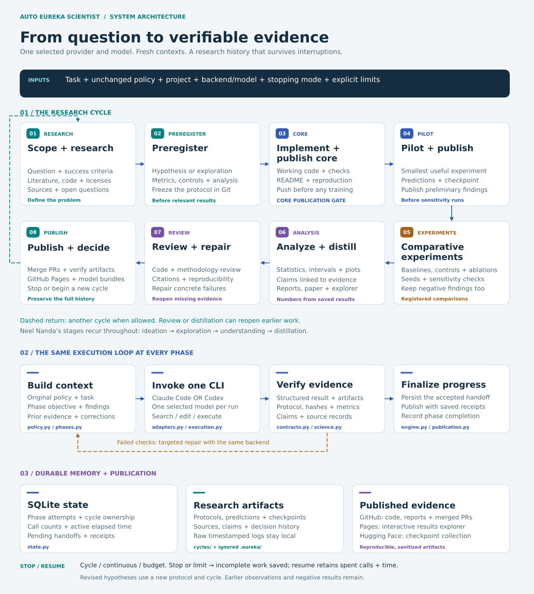

# Architecture and recovery

[Research phases at full size](../reports/figures/architecture-phases.svg) · [Execution and recovery at full size](../reports/figures/architecture-runtime.svg) · [Interactive diagram](https://burnycoder.github.io/auto-eureka-scientist-agent-harness/#architecture-heading)

Solid blue arrows show the usual progression. Dashed teal arrows represent an optional new cycle; dashed amber arrows return failed evidence checks to context construction for a targeted repair. Neel Nanda's research stages apply throughout the operational phases, rather than defining a separate sequence of agents. The state and publication panels show the durable records shared by those phases. A completed schema or retrieved citation is not proof of scientific truth.

`cli.py` parses commands and delegates to `engine.py`. The loop calls imported phase builders/verifiers, backend adapters, transport, publication and rendering modules. The selected CLI does research/editing/execution; the deterministic controller verifies and publishes. There is no second research/review agent.

`config.py` serializes run choices. `workspace.py` attaches or initializes directories without replacing existing instructions. `policy.py` packages the original bytes and extracts section-level evidence requirements. `contracts.py` defines the strict JSON handoff. `phases.py` injects the complete policy on every invocation and checks expected outputs. `science.py` checks prospective provenance, prediction arithmetic, split overlap, and claim/evidence classification. Source retrieval proves access, not the semantic truth of every claim.

`execution.py` uses stdin and argument arrays with `shell=False`. Concurrent chunk readers preserve partial/long/Unicode output, raw bytes, and timestamped readable transcripts. Cancellation/deadlines terminate the owned process tree; no unrelated agent sessions are targeted. Native provider behavior, tools and refusal policies remain outside the harness's control.

`state.py` stores runs, charged attempts, accepted phases, cycle ownership, and publication receipts in SQLite transactions. A PID plus process creation time prevents two live controllers from writing the same project concurrently. A heartbeat persists active elapsed time. A machine crash may lose up to the last heartbeat interval; it does not reset the call count. Raw prompts/output remain local under `.eureka`.

New runs and continuing cycles reserve a project-wide cycle number in a SQLite write transaction. Existing cycle directories count even when attaching a public clone without private state. Initialization never prepares or rewrites an earlier cycle. Cycle limits count cycles reserved by the current run, not the directory number; earlier run counters and observations remain unchanged. Older databases recover cycle ownership from their existing runs, attempts and phases. Prompts include earlier cycle summaries and links to their evidence histories. Explicit cycle inspection selects that cycle's recorded backend, including in public clones.

The accepted handoff is persisted before publication. If a network operation fails, `resume` rechecks its files and finalizes the pending phase without another model call. Receipt keys identify repository creation, GitHub checkpoints and content-specific HF uploads. Immutable protocol snapshots and Git commits preserve earlier hypotheses. The decisions JSONL retains every accepted backedge, even when the current phase row is replaced.

The agent may reopen missing evidence during distillation. A changed hypothesis after results creates a separate cycle, not an edited historical preregistration. New confirmation still requires untouched evaluation data; the fixed digits benchmark must not be reused to claim novel confirmation after adaptive changes.

An accepted hypothesis-revision decision is saved before checking the cycle allowance. If that allowance is exhausted, an explicit extension resumes the saved transition without another review invocation. The incomplete earlier cycle remains incomplete; its observations are not relabeled as a completed study.

The controller performs bounded targeted repair and transport retries. On budget exhaustion or persistent failure, status remains incomplete and artifacts survive. `reports/run-*.json` is a sanitized execution summary; raw transcripts are excluded. Resume retains the selected provider/model and consumed budgets. Use new ordinary runs for intentional model comparisons.

An explicit resume limit overrides the previous limit and is appended to configuration history with the current counters and prior status. It never restores spent calls or time. Draft `verify --phase` checks let the selected agent repair artifacts inside an invocation. Unambiguous artifact paths can be cycle-relative or project-relative; hashes and scientific classifications still require validation. Claude's empty navigation/nonapplicability fields can be omitted; Codex retains its strict output schema.

Publication uses authenticated `gh` and `hf` commands, meaningful feature branches, merge commits that preserve preregistration history, checkpoint receipts, and Pages Actions. Before committing, it checks tracked credential paths and common secret signatures. This is a publication exclusion check explicitly requested by the user, not an action classifier. It is not a comprehensive secret scanner. GitHub and HF service outages remain possible; receipts never replace checking the public URLs.

No sandbox, container, additional permission dialog, or action allowlist is supplied by the harness. Its unrestricted execution flags are explicit in `adapters.py`. The validation profile suppresses native delegated Codex agents and pins Claude helpers so inference cannot silently escape the chosen model/call accounting.

Only the supplied digits profile has live validation evidence. The general controller can initialize or attach other projects, but the bundled numerical reporting specializes in saved classification predictions, validation-loss histories and the registered regularization comparison. Other domains need appropriate metric calculations and verification rules; schema completion alone is insufficient evidence that a new domain is scientifically supported.

## Regenerating the diagrams

The overview, print layouts and accessible website descriptions share [one source module](../src/auto_eureka_scientist/architecture.py). Its phase keys are checked against the controller's `PHASES` contract. `uv run --extra research --extra cuda python scripts/summarize_validation.py` regenerates the README assets, paper figures and website views together with the existing numerical report. `eureka render` also uses these views in newly rendered study reports and explorers. The website offers view selection, keyboard-operable zoom, a fit control, a full-size vector link and a text description.
