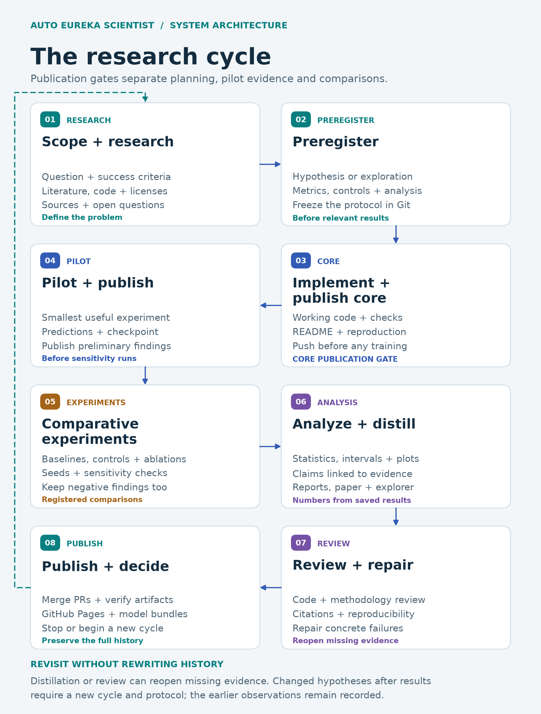
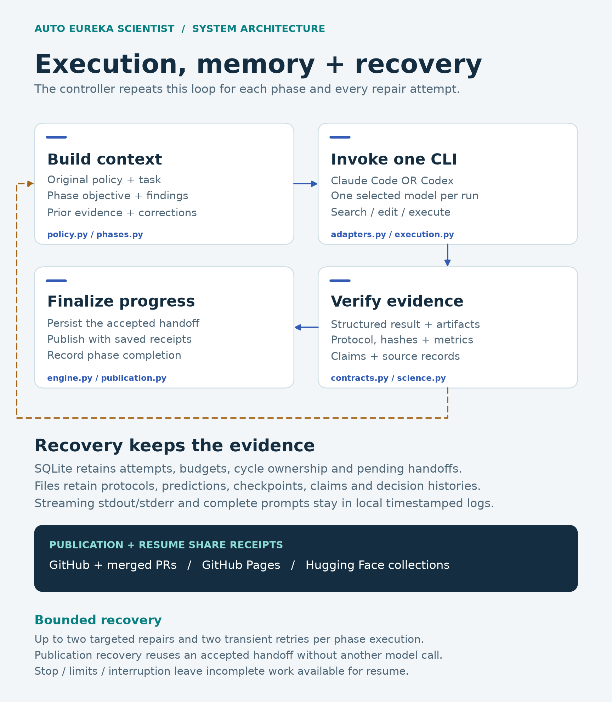
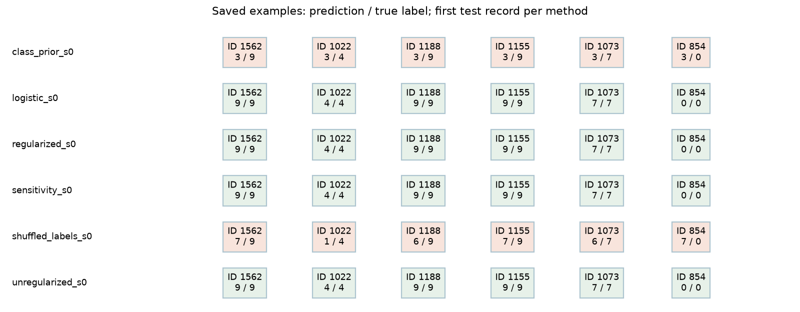

# Abstract

This report documents bounded executions of a resumable research harness through separately selected coding CLIs. It evaluates observable completion and provenance, not broad scientific competence or comparative provider superiority.

# Context, motivation, and introduction

Long-running research needs persistent evidence, prospective protocols and truthful failure reporting. The harness connects fresh contexts through files and transactional state, then checks phase-specific outputs before accepting progress.

# Background, methods, and related work

The architecture draws on [Anthropic's harness design](https://www.anthropic.com/research/effective-harnesses-for-long-running-agents) and [Neel Nanda's research process](https://www.alignmentforum.org/s/5GT3yoYM9gRmMEKqL). Statistical and reporting guidance comes from [Lones](https://arxiv.org/abs/2108.02497), [Lipton and Steinhardt](https://arxiv.org/abs/1807.03341), and the [NeurIPS checklist](https://neurips.cc/public/guides/PaperChecklist). Source/license decisions are documented in docs/sources.md.

The local operator console adds schema-driven configuration, a versioned spec queue, serial budgeted Q&A, conversational steering and replayable execution events using [FastAPI SSE](https://fastapi.tiangolo.com/tutorial/server-sent-events/). An owned worker continues independently of browser connections. Loop counts advance only after the existing phase checks and required publication succeed; active-time accounting includes chat and configured delays and excludes operator pauses. Immutable spec snapshots and transactional completion markers preserve recovery semantics. This changes the harness interface and control plane, not the scientific methods or previously observed results. Separate console engineering evidence and its Haiku/Luna-only prospective smoke protocol are documented in reports/console-acceptance.md and reports/console-validation-preregistration.md.

The original bounded trials follow reports/validation-preregistration.md. The user-authorized Haiku continuation and Sonnet/GPT-6.1 Sol replications follow reports/validation-extension-preregistration.md. Original and extended Haiku rows are successive observations of the same run, not independent trials. Sonnet and Sol use known evaluation data and are explicitly exploratory engineering replications. The scientific definitions retain the fixed weight-decay comparison, simple baselines, shuffled training labels, registered seeds and descriptive sensitivity. Test-example bootstrap intervals condition on the trained models. The shared implementation is a confound for any claim about independent algorithm discovery.

\clearpage

{width=95%}

*Operational phases. Distillation and review may reopen earlier work; changed hypotheses preserve earlier observations in a separate cycle.*

\clearpage

{width=100%}

*Execution architecture. The selected CLI produces evidence; the controller verifies, persists and publishes it. See [architecture and recovery](https://github.com/BurnyCoder/auto-eureka-scientist-agent-harness/blob/main/docs/architecture.md) for implementation details.*

\clearpage

# Results, claims, discussion, and implications

# Recorded validation outcomes

| Trial | Recorded status | Phases | Calls | Minutes |
|---|---|---:|---:|---:|
| haiku-original | budget exhausted | 5 | 17 | 60.00 |
| haiku-extended | complete | 8 | 20 | 72.80 |
| luna | complete | 8 | 10 | 27.29 |
| sonnet | complete | 8 | 9 | 13.25 |
| sol | complete | 8 | 8 | 49.13 |

The saved offline test report records 47 tests, 0 failures and 0 errors.

## haiku-original

[Repository](https://github.com/BurnyCoder/eureka-digits-haiku) · [Explorer](https://github.com/BurnyCoder/eureka-digits-haiku/blob/6f82ace83643fe2b4329ff18dce34d364cc00506/site/paper.pdf) · [Model bundle](https://huggingface.co/BurnyCoder/eureka-digits-haiku-models)

Recorded status: budget_exhausted. budget_exhausted

Its saved experiment records are unchanged in the continuation. Scientific tables and figures are shown once under haiku-extended; the original cutoff remains in the execution table and linked historical paper.

## haiku-extended

[Repository](https://github.com/BurnyCoder/eureka-digits-haiku) · [Explorer](https://BurnyCoder.github.io/eureka-digits-haiku/) · [Model bundle](https://huggingface.co/BurnyCoder/eureka-digits-haiku-models)

Recorded status: complete. All required phases completed

| Method | Seed | Split | Accuracy | Seconds | Device |
|-------------------------|-----:|------------|-----------:|----------:|----------|
| class prior | 0 | test | 0.102778 | 0.026 | cpu |
| logistic | 0 | test | 0.955556 | 0.107 | cpu |
| regularized | 0 | validation | 0.966574 | 6.805 | cuda |
| regularized | 0 | test | 0.963889 | 0.486 | cuda |
| regularized | 1 | test | 0.969444 | 6.630 | cuda |
| regularized | 2 | test | 0.969444 | 2.553 | cuda |
| sensitivity | 0 | test | 0.963889 | 2.525 | cuda |
| sensitivity | 1 | test | 0.969444 | 2.583 | cuda |
| sensitivity | 2 | test | 0.969444 | 2.481 | cuda |
| shuffled labels | 0 | test | 0.061111 | 2.465 | cuda |
| shuffled labels | 1 | test | 0.116667 | 2.470 | cuda |
| shuffled labels | 2 | test | 0.108333 | 2.367 | cuda |
| unregularized | 0 | test | 0.963889 | 2.426 | cuda |
| unregularized | 1 | test | 0.969444 | 2.393 | cuda |
| unregularized | 2 | test | 0.969444 | 2.501 | cuda |

Mean paired accuracy effect: 0.000000; conditional 95% interval [0.000000, 0.000000]. Decision: **inconclusive**. Seed-effect sample SD: 0.000000.

## luna

[Repository](https://github.com/BurnyCoder/eureka-digits-luna) · [Explorer](https://BurnyCoder.github.io/eureka-digits-luna/) · [Model bundle](https://huggingface.co/BurnyCoder/eureka-digits-luna-models)

Recorded status: complete. All required phases completed

| Method | Seed | Split | Accuracy | Seconds | Device |
|-------------------------|-----:|------------|-----------:|----------:|----------|
| class prior | 0 | test | 0.102778 | 0.038 | cpu |
| logistic | 0 | test | 0.955556 | 0.107 | cpu |
| regularized | 0 | validation | 0.966574 | 7.616 | cuda |
| regularized | 0 | test | 0.963889 | 0.288 | cuda |
| regularized | 1 | test | 0.969444 | 6.002 | cuda |
| regularized | 2 | test | 0.969444 | 2.192 | cuda |
| sensitivity | 0 | test | 0.963889 | 2.394 | cuda |
| sensitivity | 1 | test | 0.969444 | 2.348 | cuda |
| sensitivity | 2 | test | 0.969444 | 2.258 | cuda |
| shuffled labels | 0 | test | 0.061111 | 2.333 | cuda |
| shuffled labels | 1 | test | 0.116667 | 2.353 | cuda |
| shuffled labels | 2 | test | 0.108333 | 2.369 | cuda |
| unregularized | 0 | test | 0.963889 | 2.235 | cuda |
| unregularized | 1 | test | 0.969444 | 2.374 | cuda |
| unregularized | 2 | test | 0.969444 | 2.323 | cuda |

Mean paired accuracy effect: 0.000000; conditional 95% interval [0.000000, 0.000000]. Decision: **inconclusive**. Seed-effect sample SD: 0.000000.

## sonnet

[Repository](https://github.com/BurnyCoder/eureka-digits-sonnet) · [Explorer](https://BurnyCoder.github.io/eureka-digits-sonnet/) · [Model bundle](https://huggingface.co/BurnyCoder/eureka-digits-sonnet-models)

Recorded status: complete. All required phases completed

| Method | Seed | Split | Accuracy | Seconds | Device |
|-------------------------|-----:|------------|-----------:|----------:|----------|
| class prior | 0 | test | 0.102778 | 0.030 | cpu |
| logistic | 0 | test | 0.955556 | 0.124 | cpu |
| regularized | 0 | validation | 0.966574 | 8.906 | cuda |
| regularized | 0 | test | 0.963889 | 0.266 | cuda |
| regularized | 1 | test | 0.969444 | 6.516 | cuda |
| regularized | 2 | test | 0.969444 | 2.524 | cuda |
| sensitivity | 0 | test | 0.963889 | 2.625 | cuda |
| sensitivity | 1 | test | 0.969444 | 2.594 | cuda |
| sensitivity | 2 | test | 0.969444 | 2.621 | cuda |
| shuffled labels | 0 | test | 0.061111 | 2.660 | cuda |
| shuffled labels | 1 | test | 0.116667 | 2.385 | cuda |
| shuffled labels | 2 | test | 0.108333 | 2.384 | cuda |
| unregularized | 0 | test | 0.963889 | 2.455 | cuda |
| unregularized | 1 | test | 0.969444 | 2.447 | cuda |
| unregularized | 2 | test | 0.969444 | 2.443 | cuda |

Mean paired accuracy effect: 0.000000; conditional 95% interval [0.000000, 0.000000]. Decision: **inconclusive**. Seed-effect sample SD: 0.000000.

## sol

[Repository](https://github.com/BurnyCoder/eureka-digits-sol) · [Explorer](https://BurnyCoder.github.io/eureka-digits-sol/) · [Model bundle](https://huggingface.co/BurnyCoder/eureka-digits-sol-models)

Recorded status: complete. All required phases completed

| Method | Seed | Split | Accuracy | Seconds | Device |
|-------------------------|-----:|------------|-----------:|----------:|----------|
| class prior | 0 | test | 0.102778 | 0.027 | cpu |
| logistic | 0 | test | 0.955556 | 0.109 | cpu |
| regularized | 0 | validation | 0.966574 | 6.083 | cuda |
| regularized | 0 | test | 0.963889 | 0.373 | cuda |
| regularized | 1 | test | 0.969444 | 5.740 | cuda |
| regularized | 2 | test | 0.969444 | 2.151 | cuda |
| sensitivity | 0 | test | 0.963889 | 2.098 | cuda |
| sensitivity | 1 | test | 0.969444 | 2.105 | cuda |
| sensitivity | 2 | test | 0.969444 | 2.121 | cuda |
| shuffled labels | 0 | test | 0.061111 | 2.190 | cuda |
| shuffled labels | 1 | test | 0.116667 | 2.194 | cuda |
| shuffled labels | 2 | test | 0.108333 | 2.103 | cuda |
| unregularized | 0 | test | 0.963889 | 2.032 | cuda |
| unregularized | 1 | test | 0.969444 | 2.142 | cuda |
| unregularized | 2 | test | 0.969444 | 2.203 | cuda |

Mean paired accuracy effect: 0.000000; conditional 95% interval [0.000000, 0.000000]. Decision: **inconclusive**. Seed-effect sample SD: 0.000000.

## Interpretation and limitations

The engineering endpoint is verified phase and artifact completion, independent of the direction of the regularization effect. The original bounded Haiku trial reached its active-time cap with analysis, review and final publication unaccepted. That historical cutoff did not satisfy the completion criterion. Its initial draft claims and interpretation were excluded from the generated paper and explorer at that cutoff. Parent publication of available results did not complete the missing phases.

The user subsequently authorized more time, interface repairs, and additional models. The original Haiku cutoff remains a separate immutable snapshot. The extended Haiku row reports cumulative consumption from the same run, including its original attempts; it is not another independent sample. The [prospective addendum](validation-extension-preregistration.md) records this change before resumed inference. Interface changes address concrete path, handoff and evidence-ledger failures. More time and a changed harness are confounded, so successful continuation cannot isolate which intervention caused improvement.

Luna's controller accepted the workflow within its limits. A later audit found that Git newline conversion and regenerated documents invalidated evidence hashes. Exact historical bytes were recovered from reversible newline changes and saved review copies, then pinned in immutable snapshots. The final repaired artifacts pass the recorded checks; this outcome required post-run mechanical repair and does not demonstrate untouched autonomous completion. Initial failures, diagnosis and repaired receipts are retained in `reports/verification/` and the trial repository.

The original trials actually used search, editing, execution, CUDA training, reporting and publication. Their prospective protocol and tested harness were pushed before live calls. Pilot checkpoint publication preceded sensitivity experiments. Only the selected provider/model was invoked within each run. Reported model identities in the generated table come from CLI events; missing identities must not be replaced by an assumed snapshot.

Sonnet and GPT-6.1 Sol are separate engineering replications with prior scientific outcomes known. Their protocols and result classifications are exploratory. The requested Sol identifier is the newer GPT-6.1 Sol explicitly selected by the user. Each new execution uses its own project and repository; the shared Hugging Face collection groups all model bundles. The generated table and per-trial summaries determine which phases actually completed; authorization and setup do not count as successful validation.

The trials share the supplied training algorithm and fixed scientific definitions. Their full source files and protocol metadata are not byte-identical: checking code was repaired during development, and later protocols explicitly classify the known-result replications as exploratory. Matching scientific predictions therefore do not show independent algorithm invention. Later executions inherited harness repairs. Active time excludes controller downtime between resumes; repair and post-run verification work is disclosed separately. The table records these executions, not a fair provider comparison, frozen-version benchmark or guarantee about future research.

The first Sonnet research attempt reported both Sonnet and Haiku because a native background WebFetch summary used a separate model setting. The controller rejected that attempt and retained its consumed budget. Resumption pinned the observed Sonnet identity in the main session, helper and background settings; subsequent reported identities are recorded per attempt. This trial cannot be described as pure Sonnet from inception. Its failure and repair are evidence about the adapter, not a provider comparison.

The completed Haiku extension still needed a parent semantic review. Overstatements about a hard detection limit, a causal explanation from checkpoint norms, and the interpretation of post-hoc negative log likelihood were corrected and disclosed in the trial's `reports/extended-parent-review.md`. Original measurements, checkpoints and consumed counters were unchanged. Passing structural artifact checks does not establish that every authored claim is scientifically sound.

Sonnet's original public artifacts passed checkpoint and phase verification. Parent review nevertheless narrowed claims about what differing weights prove, withdrew an unsupported sampling-noise explanation, clarified that the record set includes a validation pilot, and corrected checklist entries that treated controller-owned work as inapplicable. The historical model submissions remain with notices linking to [the correction record](https://github.com/BurnyCoder/eureka-digits-sonnet/blob/main/reports/parent-review.md). PDF inspection and browser interactions were performed separately by the parent. This is a completed development execution with disclosed interventions, not evidence of flawless autonomous research.

Sol's core phase exposed a controller overwrite after a successful model call. Its cited audit was replaced by the controller's repeat-check receipt before preservation. The parent recovered only bytes matching the audit's existing hash, repaired the snapshot ordering and resumed the saved handoff without another inference call. [The repair report](core-check-evidence-repair.md) and retained blocked-run snapshot disclose that intervention outside the model clock. Subsequent completion does not erase that development failure.

Sol completed the remaining phases. Parent verification reproduced its downloaded checkpoints, inspected the final PDF and exercised its public explorer. The parent corrected an inaccurate lockfile statement and composed the existing numerical builders and presentation repair into a single-command rebuild; scientific records and model weights were unchanged. The shared renderer now preserves experiment/split labels on examples and links the cycle reproduction guide. These changes and later checks are disclosed in [Sol's parent review](https://github.com/BurnyCoder/eureka-digits-sol/blob/main/reports/parent-review.md). Its original failed browser connection is retained rather than represented as successful model-operated browser verification.

The primary directional result is inconclusive. The observed paired correctness outcomes coincide, causing the empirical bootstrap interval to collapse. This is not an equivalence test or a guarantee about unseen examples. The intervals condition on the fitted models and fixed example split; seed variability is separate and neither covers new writers or datasets. Descriptive control and sensitivity outcomes remain exploratory. Near-chance shuffled-label performance cannot rule out every implementation error or leakage pathway.

The pilot fixture evaluates test features without their labels when checking checkpoint reload; only validation predictions are scored and saved for the pilot. Claims that no test features were accessed would be inaccurate. No test outcome selected the registered configuration. The available dataset fields do not support a writer-held-out evaluation.

Public checkpoints were loaded with tensor-only or non-pickle readers and their predictions compared with saved records. Numerical tables are recomputed from raw predictions; figures use explicit scales and identify unavailable measurements. PDF pages and interactive filters were inspected separately. These checks establish specific reproducible artifacts, not semantic correctness of every source or general scientific validity. Reward curves and model weights for the harness itself are inapplicable; the supervised validation studies provide loss curves and model collections.

## haiku-extended: Recorded accuracies

*Recorded accuracies; regenerated from saved predictions.*

## haiku-extended: First saved test examples per method

*First saved test examples per method; regenerated from saved predictions.*

## luna: Recorded accuracies

*Recorded accuracies; regenerated from saved predictions.*

## luna: First saved test examples per method

*First saved test examples per method; regenerated from saved predictions.*

## sonnet: Recorded accuracies

*Recorded accuracies; regenerated from saved predictions.*

## sonnet: First saved test examples per method

*First saved test examples per method; regenerated from saved predictions.*

## sol: Recorded accuracies

*Recorded accuracies; regenerated from saved predictions.*

## sol: First saved test examples per method

*First saved test examples per method; regenerated from saved predictions.*

\clearpage

# Conclusion

These are particular observed executions. Successful artifact checks do not prove semantic correctness, causal validity, or source support. Negative and incomplete outcomes remain part of the record.

# Appendix: reproduction

Install the locked harness environment and run `uv run --extra research python scripts/summarize_validation.py`. Saved validation JSON supports regenerating this report without private transcripts or further model calls. Trial repositories retain their protocols, predictions, code and publication history; checkpoints reside in the corresponding model bundles.

# AI statement

Codex wrote this harness codebase and report from the exact specification supplied by a human. The selected CLI performed each trial's research phases. Human cleanup and rewriting are in progress.
